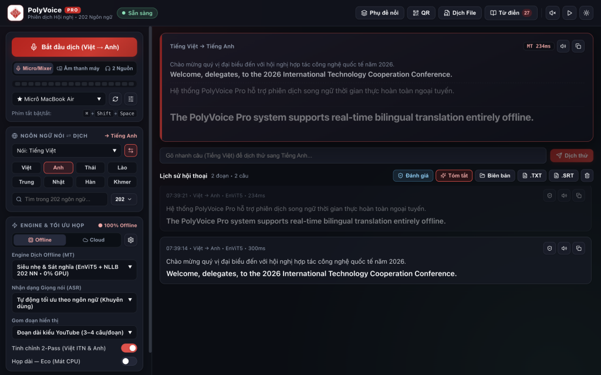
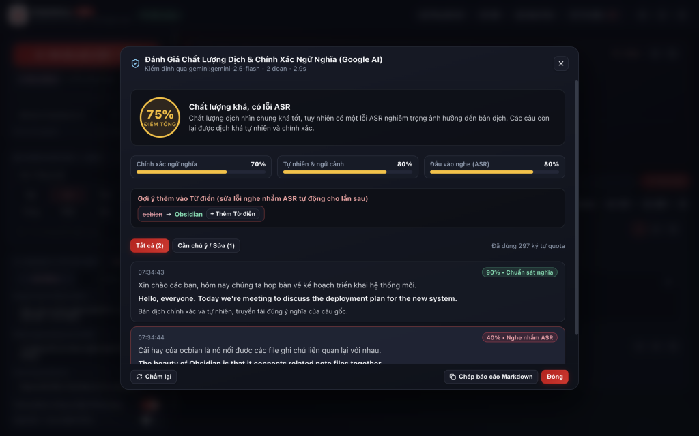
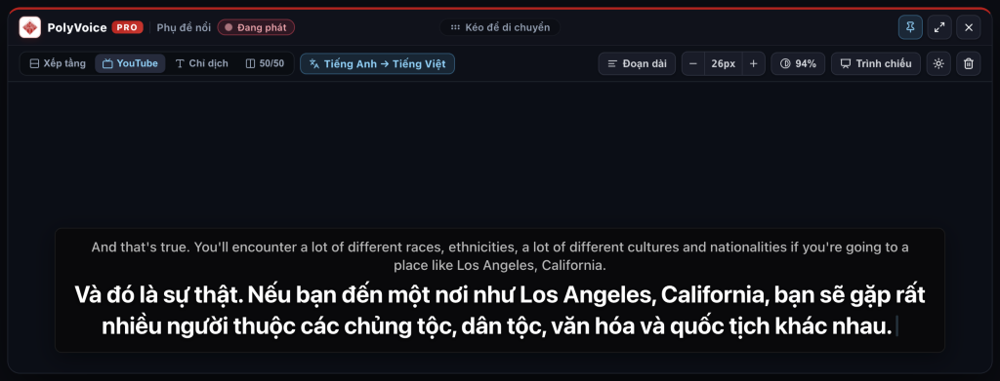
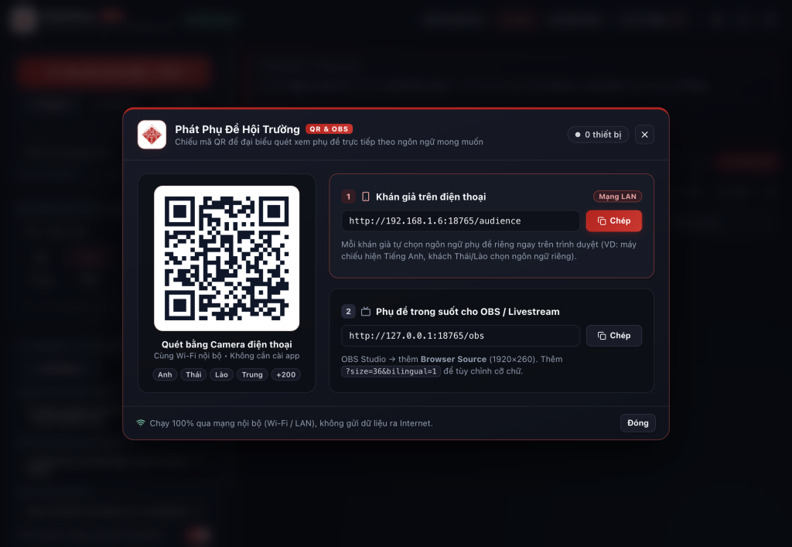
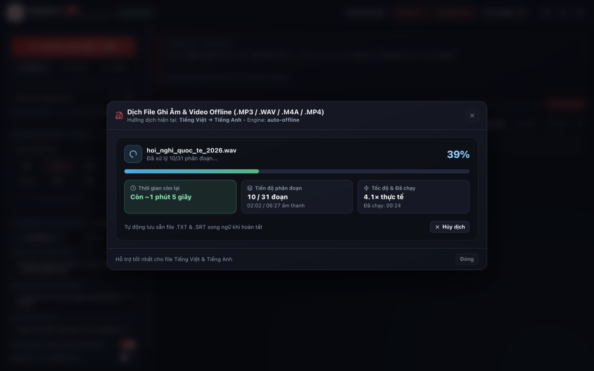
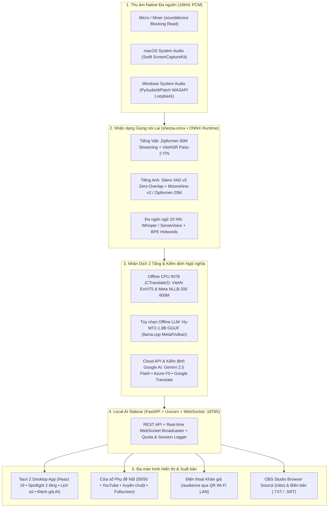

<div align="center">


# DAU Voice Pro

**Hệ thống Phiên dịch Hội nghị Song ngữ Thời gian thực — 20 Ngôn ngữ Nói ⇄ 202 Ngôn ngữ Dịch**
<br />
*100% Offline siêu nhẹ (0% GPU • Không cần PyTorch) • Công tắc Cloud API Chính Thức • Kiểm định Chất lượng Dịch bằng Google AI*

[](https://github.com/niitbeo/PolyVoice-Pro/releases/latest)
[](https://github.com/niitbeo/PolyVoice-Pro/releases)
[](https://tauri.app/)
[](https://opennmt.net/CTranslate2/)
[](https://github.com/niitbeo/PolyVoice-Pro/releases)

[Tính năng nổi bật](#-tính-năng-nổi-bật) •
[Hình ảnh giao diện](#-hình-ảnh-giao-diện) •
[Kiến trúc hệ thống](#-kiến-trúc-hệ-thống) •
[Công nghệ & Mô hình AI](#-công-nghệ--mô-hình-ai-sử-dụng) •
[Hiệu năng thực đo](#-hiệu-năng-thực-đo) •
[Cài đặt](#-tải-về--cài-đặt) •
[Phát triển](#-chạy-chế-độ-phát-triển--phát-hành)

<br />



</div>

---

## 🎯 Tổng quan

**DAU Voice Pro** là ứng dụng desktop đa nền tảng (**macOS Apple Silicon** & **Windows x64**) chuyên dụng cho **hội nghị quốc tế, họp trực tuyến Zoom/Teams/Meet, giảng dạy song ngữ và livestream sự kiện**.

Thay vì phụ thuộc vào các thư viện AI nặng nề (như PyTorch hàng GB hay yêu cầu card đồ họa rời), DAU Voice Pro sử dụng **nhân suy luận C++/ONNX/CTranslate2 INT8** đóng gói thành sidecar độc lập ngay trong file cài đặt — đạt độ trễ dịch nháp **`~68–161 ms`** và chốt câu **`~134–212 ms`** ngay trên CPU laptop phổ thông (**0% GPU**), đồng thời giữ nguyên 100% quyền riêng tư âm thanh nội bộ.

---

## ✨ Tính năng nổi bật

### 1. Phiên dịch Offline siêu nhẹ — 0% GPU, Tự xả RAM thông minh
- **Gói AI cốt lõi chỉ ~1.18 GB:** Chạy mượt trên MacBook Air và laptop văn phòng không có GPU rời. Tự động giải phóng RAM (`_release_unused_models`) ngay khi đổi ngôn ngữ hoặc chuyển chế độ dịch.
- **Nhận dạng Giọng nói Lai (Hybrid Streaming ASR):**
  - **Tiếng Việt:** `Zipformer-30M` streaming độ trễ thấp kết hợp **Tinh chỉnh Pass-2 (`VietASR ITN`)** tự động chuẩn hóa số liệu, ngày tháng, viết hoa và dấu câu.
  - **Tiếng Anh:** Kiến trúc lai **Zero-Overlap `Silero VAD v5` + `Moonshine-v2` / `Zipformer-20M`** chống lặp chữ tuyệt đối ngay cả trong phòng họp dội âm, kèm bộ lọc chống ảo giác nhạc nền.
  - **Đa ngôn ngữ (20 ngôn ngữ nói):** Tự động định tuyến sang `Whisper` / `SenseVoice` (Thái, Lào, Trung, Nhật, Hàn, Pháp, Đức, Nga...).
- **Dịch máy 2 tầng (Việt ⇄ Anh & 202 Ngôn ngữ):** `VietAI EnViT5` chuyên biệt cho cặp Việt ⇄ Anh (`~134–212 ms`), `Meta NLLB-200 600M INT8` cho **202 ngôn ngữ**, và tùy chọn mở rộng `Hy-MT2-1.8B` (`llama.cpp` GGUF) cho máy cấu hình cao.

### 2. Kiểm định Chất lượng Dịch & Chính xác Ngữ nghĩa bằng Google AI *(Mới ở v0.9.5)*
- **2 điểm chạm trực tiếp trong Lịch sử:** Nút **`Đánh giá`** trên thanh công cụ để chấm toàn bộ phiên họp, và icon chiếc khiên (`ShieldCheck`) trên từng thẻ hội thoại để kiểm định tức thì riêng từng câu.
- **Phân tích chuyên sâu qua `Google Gemini 2.5 Flash`** *(tự dự phòng sang Google Cloud Translation v2)*:
  - Chấm **điểm tổng `0–100%`** kèm 3 chỉ số thành phần: *Chính xác ngữ nghĩa*, *Tự nhiên & ngữ cảnh*, *Đầu vào nghe (ASR)*.
  - Phân biệt chính xác 4 loại trạng thái: `Chuẩn sát nghĩa`, `Hơi thô / Sắc thái`, `Sai / Lệch nghĩa`, và **`Nghe nhầm ASR`**.
  - **Sửa lỗi 1 chạm:** Bấm **`Áp dụng bản sửa`** để cập nhật ngay vào Lịch sử & file xuất `.TXT`/`.SRT`; bấm chip **`+ Thêm Từ điển`** để tự sửa lỗi nghe nhầm tên riêng/thuật ngữ cho các lần dịch sau.

### 3. Công tắc 1 chạm `Offline | Cloud API` Chính Thức
- Chuyển đổi tức thì giữa **100% Offline** và **Cloud API** ngay trong lúc đang dịch: hỗ trợ **Google Gemini (`gemini-2.5-flash`)**, **Microsoft Azure Translator (Free F0 — 2 triệu ký tự/tháng)** và **Google Cloud Translation (500 nghìn ký tự/tháng)**.
- **Tiết kiệm ~85% hạn mức:** Nháp chữ chạy trực tiếp lúc diễn giả đang nói luôn dùng engine Offline, chỉ gọi Cloud API cho câu chốt hoàn chỉnh, kèm bộ đếm hạn mức tự khóa ở ngưỡng miễn phí (0 đồng).

### 4. Trọn bộ Công cụ Hội trường, Họp Trực tuyến & Livestream
- **Cửa sổ Phụ đề Nổi đa chế độ:** Hỗ trợ **`Xếp tầng`**, **`YouTube`**, **`Chỉ dịch`**, **`50/50 Song ngữ`**, kéo sang màn hình chiếu thứ 2, **`Đầy màn hình`**, **`Xuyên chuột`**, điều chỉnh cỡ chữ & độ trong suốt linh hoạt.
- **Phát phụ đề đa ngôn ngữ qua QR Wi-Fi Nội bộ (`/audience`):** Đại biểu quét mã QR trên điện thoại (chạy qua mạng LAN/Wi-Fi, không cần cài app, không cần Internet) và **tự chọn ngôn ngữ phụ đề riêng** (Anh, Thái, Lào, Khmer, Trung, Nhật, Hàn...).
- **OBS Browser Source (`/obs`):** Nền trong suốt sẵn sàng ghép trực tiếp vào OBS Studio / vMix / Livestream sự kiện.
- **Thu âm 2 chiều (`[Bạn]` + `[Đối tác]`):** Ghi đồng thời Micro/Mixer và Âm thanh hệ thống (Zoom, Google Meet, Microsoft Teams, YouTube) bằng `ScreenCaptureKit` native trên macOS và `WASAPI Loopback` trên Windows.
- **Dịch File ghi âm & video Offline:** Kéo thả `.mp3`, `.wav`, `.m4a`, `.mp4` với thanh tiến độ phần trăm, tốc độ xử lý (`4x+` thực tế), ước tính ETA và tự xuất sẵn biên bản `.TXT` + phụ đề `.SRT`.
- **Từ điển Họp + BPE Hotwords & Tóm tắt cuộc họp song ngữ:** Khai báo tên riêng, thuật ngữ chuyên ngành để tăng độ chính xác nhận dạng ngay từ tầng ASR.

---

## 🖼️ Hình ảnh Giao diện

<table>
  <tr>
    <td width="50%" valign="top">
      
      <p align="center"><b>Kiểm định Chất lượng Dịch bằng Google AI</b><br /><sub>Chấm điểm ngữ nghĩa 0–100%, phân biệt lỗi dịch vs lỗi nghe ASR, gợi ý thêm Từ điển & áp dụng bản sửa 1 chạm.</sub></p>
    </td>
    <td width="50%" valign="top">
      
      <p align="center"><b>Cửa sổ Phụ đề Nổi Hội trường (Chế độ YouTube / 50-50)</b><br /><sub>Nền trong suốt, kéo sang màn hình thứ 2, xuyên chuột, hỗ trợ chế độ Xếp tầng, YouTube, Chỉ dịch và Chia đôi 50/50.</sub></p>
    </td>
  </tr>
  <tr>
    <td width="50%" valign="top">
      
      <p align="center"><b>Mã QR Khán giả Nội bộ & OBS Browser Source</b><br /><sub>Khán giả quét QR bằng điện thoại qua Wi-Fi LAN để chọn ngôn ngữ riêng trong 202 ngôn ngữ; tích hợp sẵn URL OBS.</sub></p>
    </td>
    <td width="50%" valign="top">
      
      <p align="center"><b>Dịch File Ghi âm & Video Offline (.MP3 / .WAV / .MP4)</b><br /><sub>Xử lý hoàn toàn trên máy nhanh gấp ~4x thời gian thực, hiển thị ETA trực quan và tự xuất biên bản .TXT / .SRT.</sub></p>
    </td>
  </tr>
</table>

---

## 🏗️ Kiến trúc Hệ thống



---

## 🛠️ Công nghệ & Mô hình AI sử dụng

### 1. Stack Ứng dụng Desktop, Hệ thống Native & Backend

| Lớp hệ thống | Công nghệ & Thư viện | Vai trò trong DAU Voice Pro |
| :--- | :--- | :--- |
| **Desktop Shell** | **Tauri 2** (Rust) + `tauri-plugin-updater` + `tauri-plugin-global-shortcut` | Khung ứng dụng native siêu nhẹ (RAM thấp hơn Electron nhiều lần), cửa sổ Phụ đề Nổi trong suốt xuyên chuột, phím tắt toàn cục và cập nhật tự động ký số **Ed25519**. |
| **Frontend UI** | **React 19** + **TypeScript 5.8** + **Vite 6** + **Lucide Icons** | Giao diện **Crimson Academic Pro** (Sáng & Tối), dòng chảy phụ đề 2 tầng mượt không giật DOM, quản lý Lịch sử, Từ điển và Báo cáo Kiểm định Google AI. |
| **Local AI Server** | **Python 3.12** (`uv`) + **FastAPI** + **Uvicorn** + **WebSockets** + **httpx** | Backend sidecar chạy cục bộ tại cổng `:18765`, điều phối đa luồng thu âm – ASR – dịch nháp/chốt – phát WebSocket đồng thời cho App, Overlay, điện thoại khán giả và OBS. |
| **Đóng gói Độc lập** | **PyInstaller** (Standalone Sidecar Binary) | Đóng gói toàn bộ Python runtime + thư viện ONNX/CTranslate2 thành file thực thi nhúng sẵn trong `.dmg` / `.exe` (người dùng **không cần cài Python**). |
| **Thu âm Native** | **Swift `ScreenCaptureKit`** (macOS 13+), **`PyAudioWPatch` WASAPI Loopback** (Windows), **`sounddevice`** (Blocking Read) | Thu âm thanh hệ thống chất lượng cao không cần cài driver ảo (như BlackHole/VB-Cable), tách luồng đọc chặn an toàn chống lỗi `libffi`/PortAudio trên macOS ARM64. |
| **Xử lý Media & QR** | **`imageio-ffmpeg`** + **`segno`** + **NumPy** | Giải mã đa định dạng âm thanh/video (`.mp3`, `.wav`, `.m4a`, `.mp4`) cho tính năng Dịch File Offline và tạo mã QR cục bộ không cần dịch vụ ngoài. |
| **CI/CD & Phát hành** | **GitHub Actions** (`windows-latest` + `macos-latest`) + **Minisign / Ed25519** | Tự động build sidecar, smoke-test sức khỏe engine, đóng gói bộ cài `.exe`/`.msi`/`.dmg`, ký số xác thực và sinh `latest.json` cho cơ chế Auto-Update. |

### 2. Hệ sinh thái Mô hình AI Offline *(0% GPU mặc định • Không cần PyTorch)*

| Tác vụ | Mô hình AI | Runtime / Định dạng | Dung lượng | Vai trò & Điểm mạnh |
| :--- | :--- | :--- | :---: | :--- |
| **ASR Tiếng Việt (Live)** | **Zipformer-30M** (`sherpa-onnx`) | ONNX Runtime INT8 | ~49 MB | Nhận dạng giọng Việt theo thời gian thực độ trễ cực thấp, hỗ trợ **BPE Hotwords** từ Từ điển Họp. |
| **Tinh chỉnh Việt Pass-2** | **VietASR** (`viet-asr`) | ONNX Runtime | Tích hợp | Hậu xử lý ITN: tự động chuẩn hóa số đếm, phần trăm, ngày tháng, viết hoa và dấu câu chuẩn văn bản. |
| **ASR Tiếng Anh (Lai)** | **Silero VAD v5** + **Moonshine-v2** / **Zipformer-20M** | ONNX Runtime INT8 | ~265 MB | Kiến trúc cắt câu Zero-Overlap giúp tỷ lệ lặp chữ **0%**, chống ảo giác tiếng nhạc/tiếng ồn phòng họp. |
| **ASR 20 Ngôn ngữ** | **Whisper** / **SenseVoice** (`sherpa-onnx`) | ONNX Runtime INT8 | Tải theo nhu cầu | Nhận dạng giọng nói Thái, Lào, Trung, Nhật, Hàn, Pháp, Đức, Tây Ban Nha, Nga... |
| **Dịch Việt ⇄ Anh** | **VietAI EnViT5** | **CTranslate2 INT8** (CPU) | ~266 MB | Chuyên biệt cho cặp Anh ⇄ Việt: dịch mượt, giữ đủ ý/con số, đạt **`68–212 ms`** với **0% GPU**. |
| **Dịch 202 Ngôn ngữ** | **Meta NLLB-200 Distilled 600M** | **CTranslate2 INT8** (CPU) | ~604 MB | Bao phủ 202 ngôn ngữ (gồm Lào, Khmer, Thái, Trung, Nhật, Hàn, Ả Rập, Âu-Mỹ...) chạy 100% offline. |
| **LLM Offline (Tùy chọn)** | **Tencent Hy-MT2-1.8B** | **`llama.cpp` GGUF** (Metal / Vulkan) | ~1.05 GB | Tắt mặc định để tiết kiệm RAM/GPU; bật khi cần văn phong tự nhiên cho 38 ngôn ngữ trên máy cấu hình mạnh. |

### 3. Tích hợp Cloud API Chính Thức *(Tùy chọn bật/tắt)*

| Nhà cung cấp | Model / API | Công dụng | Bảo vệ chi phí & Bảo mật |
| :--- | :--- | :--- | :--- |
| **Google AI Studio** | **Gemini 2.5 Flash** (`gemini-2.5-flash`) | Dịch ngữ cảnh nâng cao & **Kiểm định Chất lượng Dịch ngữ nghĩa** (`0–100%`, gợi ý sửa & Từ điển). | Gửi khóa qua HTTP header `x-goog-api-key`, ép JSON chuẩn (`thinkingBudget: 0`), lưu khóa cục bộ trên máy. |
| **Microsoft Azure** | **Azure AI Translator v3** | Dịch câu chốt tốc độ cao cho 100+ ngôn ngữ (gói miễn phí **F0: 2M ký tự/tháng**). | Nháp live chạy Offline (giảm ~85% ký tự gọi API), tự khóa ở ngưỡng miễn phí. |
| **Google Cloud** | **Cloud Translation API v2** | Dịch câu chốt & chế độ dự phòng kiểm định chất lượng (gói miễn phí **500K ký tự/tháng**). | Bộ đếm `quota_tracker.py` theo dõi theo thời gian thực ngay trên giao diện. |

---

## 📊 Hiệu năng Thực đo

Đo trực tiếp trên **macOS Apple Silicon (Chế độ mặc định `Siêu nhẹ & Sát nghĩa` — `OMP_WAIT_POLICY=PASSIVE`, `intra_threads=2`, 0% GPU)**:

| Kịch bản kiểm thử | Engine thực chạy | Độ trễ thực đo | Tài nguyên hệ thống |
| :--- | :--- | :---: | :--- |
| **Việt ⇄ Anh (Nháp Live đang nói)** | `VietAI EnViT5` (CTranslate2 INT8) | **`68.9 – 161.7 ms`** | 0% GPU • Không có tiến trình `llama-server` |
| **Việt ⇄ Anh (Câu chốt hoàn chỉnh)** | `VietAI EnViT5` (`repetition_penalty=1.05`) | **`134.5 – 212.2 ms`** | 0% GPU • Giữ đủ 100% số liệu & ý phụ |
| **Thái / Lào / 202 NN (Câu chốt)** | `NLLB-200 600M` (CTranslate2 INT8) | **`767 – 850 ms`** | 0% GPU • Tự xả RAM khi đổi về Việt ⇄ Anh |
| **Kiểm định Ngữ nghĩa 1 phiên họp** | `Google Gemini 2.5 Flash` (JSON Mode) | **`~2.5 – 3.0 s`** | Phân loại chuẩn `ok / nuance / mt_inaccurate / asr_error` |
| **Dịch File ghi âm Offline (`.wav`/`.mp4`)** | `Zipformer / Moonshine` + `EnViT5` | **`~4.1×` thời gian thực** | Tự động xuất biên bản `.TXT` & phụ đề `.SRT` |

---

## 📥 Tải về & Cài đặt

### Dành cho người dùng cuối (Không cần cài Python / Node.js)

1. Truy cập trang **[GitHub Releases mới nhất](https://github.com/niitbeo/PolyVoice-Pro/releases/latest)**.
2. Tải đúng bộ cài cho máy của bạn:
   - **Windows 10/11 (64-bit):** `DAU.Voice.Pro_x.x.x_x64-setup.exe` hoặc `.msi`
   - **macOS Apple Silicon (M1 / M2 / M3 / M4):** `DAU.Voice.Pro_x.x.x_aarch64.dmg`
3. Mở ứng dụng lần đầu để app tự tải **gói mô hình AI cốt lõi (~1.18 GB)** từ Hugging Face (chỉ tải 1 lần duy nhất, sau đó dùng 100% không cần mạng).
4. **Cập nhật tự động 1 chạm:** Khi có phiên bản mới trên GitHub Releases, ứng dụng sẽ tự thông báo và cập nhật tại chỗ (giữ nguyên toàn bộ model offline, Từ điển và API Key đã lưu).

> **Lưu ý cho macOS (bản ký ad-hoc):** Nếu macOS Gatekeeper báo *"cannot be opened because the developer cannot be verified"*, chạy 1 lệnh sau trong Terminal rồi mở lại app:
> ```bash
> xattr -cr "/Applications/DAU Voice Pro.app"
> ```

---

## 💻 Chạy Chế độ Phát triển & Phát hành

### Yêu cầu môi trường
- **Node.js 22+** & **pnpm 10+**
- **Rust Toolchain (stable)** (cho Tauri 2)
- **uv** (quản lý Python 3.12 siêu tốc)
- **macOS:** Xcode Command Line Tools (để biên dịch `native-macos/helper.swift`)

### Khởi chạy Local Dev (macOS & Windows)

```bash
# 1. Cài đặt AI Backend Sidecar (Python 3.12 qua uv — không cần PyTorch)
cd engine && uv sync && cd ..

# 2. (Chỉ macOS) Biên dịch native ScreenCaptureKit Audio Helper
bash native-macos/build.sh

# 3. Cài đặt Frontend & chạy Desktop App Native
pnpm install
pnpm tauri dev
```

### Cấu trúc Thư mục Dự án

```text
VOICERECORE/
├── src/                         # Frontend React 19 + TypeScript + CSS
│   ├── App.tsx                  # Giao diện chính, Spotlight 2 tầng, Lịch sử & Google AI Audit
│   ├── OverlayWindow.tsx        # Cửa sổ Phụ đề Nổi Hội trường (50/50, YouTube, Xếp tầng)
│   ├── types.ts                 # Kiểu dữ liệu Transcript, EvaluationReport & Glossary
│   └── styles.css               # Hệ thống giao diện Crimson Academic Pro (Dark & Light)
├── src-tauri/                   # Desktop Shell Rust (Tauri 2)
│   ├── src/lib.rs               # Quản lý sidecar, Overlay xuyên chuột, phím tắt & Auto-Updater
│   └── tauri.conf.json          # Cấu hình cửa sổ, bundle & khóa công khai Ed25519
├── engine/                      # Local AI Backend Sidecar (Python 3.12 + FastAPI)
│   ├── server.py                # FastAPI + WebSocket hub, pipeline đa luồng & API đánh giá
│   ├── asr_engine.py            # Zipformer, VietASR Pass-2, Hybrid Silero VAD + Moonshine-v2
│   ├── translator.py            # EnViT5, NLLB-600M, Hy-MT2, Cloud API & Google AI Auditor
│   ├── audio_capture.py         # Thu âm Micro (blocking read), macOS Helper & Windows WASAPI
│   ├── audience_web.py          # Trang web Khán giả QR (/audience) & OBS Overlay (/obs)
│   ├── file_translator.py       # Dịch file ghi âm/video offline kèm tiến độ & xuất .SRT/.TXT
│   ├── glossary.py              # Từ điển Họp, thay thế hậu xử lý & tạo BPE Hotwords
│   ├── model_manager.py         # Tải, kiểm tra & quản lý gói model offline từ Hugging Face
│   └── quota_tracker.py         # Theo dõi hạn mức & khóa an toàn ngân sách Cloud API
├── native-macos/                # Helper Swift native dùng ScreenCaptureKit (macOS 13+)
├── scripts/                     # Script tự động hóa phát hành (release.sh, fetch_llama_server.py)
├── docs/images/                 # Hình ảnh minh họa giao diện chính thức
└── .github/workflows/           # CI/CD tự động build Windows/macOS & ký số Ed25519
```

### Phát hành phiên bản mới (1 lệnh duy nhất)

```bash
bash scripts/release.sh 0.9.5 "Mô tả tính năng hoặc bản sửa lỗi mới"
```

Script tự động đồng bộ phiên bản (`package.json`, `tauri.conf.json`, `Cargo.toml`), tạo git tag `vX.Y.Z` và đẩy lên GitHub để **GitHub Actions** tự build bản cài đặt **Windows (`.exe`/`.msi`)** + **macOS (`.dmg`)**, smoke-test sidecar, ký số **Ed25519** và phát hành kèm `latest.json` cho toàn bộ người dùng.

---

<div align="center">
<sub>Được xây dựng với ❤️ cho các hội nghị, lớp học và sự kiện đa ngôn ngữ — <b>DAU Voice Pro</b></sub>
</div>
